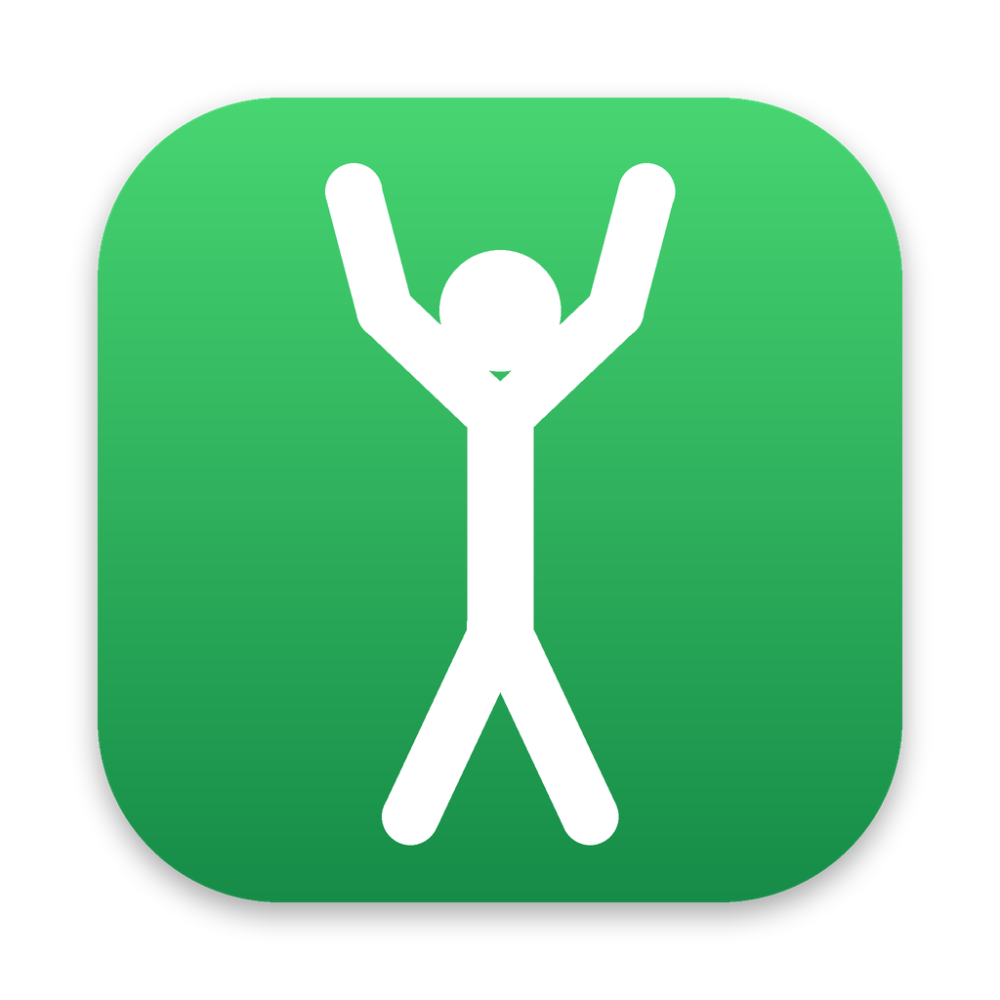

<p align="center">
  
</p>

# StretchReminder

A small, free macOS menu bar app that tells you to get up and move.

After a set time of sitting at your Mac (30 minutes by default), it covers every
screen with a big message and pauses whatever is playing. It does not close or
quit anything. When the time is up, or when you press the button, you are back
exactly where you were.

The default message is in Egyptian Arabic and you can change it to anything:

> انت قاعد بقالك كتير قوم حرك جسمك
> ("You have been sitting for a long time, get up and move your body")

It is deliberately polite about interrupting: it waits while you are in a call
or a meeting, while a Focus / Do Not Disturb is on, and while the Mac is locked
or asleep.

## Contents

- [What it does](#what-it-does)
- [Requirements](#requirements)
- [Install](#install)
- [One permission: Full Disk Access](#one-permission-full-disk-access)
- [Using it](#using-it)
- [When it stays quiet](#when-it-stays-quiet)
- [Uninstall](#uninstall)
- [Privacy and what the app touches](#privacy-and-what-the-app-touches)
- [Known limitations](#known-limitations)
- [Troubleshooting](#troubleshooting)
- [Building and contributing](#building-and-contributing)
- [License](#license)

## What it does

- **Reminder screen.** A dark full-screen message on every display. It closes by
  itself after 60 seconds (adjustable). After 5 seconds you can also close it
  with the button, Esc, Return or Space.
- **Pauses media.** If something is playing, it sends a "pause". It does not
  resume it for you afterwards.
- **Counts sitting time, not clock time.** The count restarts when you have
  clearly been away: the screen was locked or the display was off for 2 minutes
  or more, or there was no keyboard or mouse activity for 5 minutes while
  nothing was playing.
- **Menu bar icon.** Green means on, gray means off. It can show a live
  countdown to the next reminder.
- **Switches itself off when you leave.** Locking the screen or putting the Mac
  to sleep turns it off, and it stays off until you choose **Turn on** (like
  Caffeine). You can untick this in the menu if you prefer it to stay on.

## Requirements

- macOS 12 or later. Detecting which app is using the microphone is most
  precise on macOS 14.2 or later.
- Apple's Command Line Tools, because the installer compiles the app on your
  Mac. If they are missing, the installer tells you; install them with
  `xcode-select --install`.
- No administrator password is needed.

So far it has been developed and tested on one Apple Silicon Mac. Reports from
Intel Macs and other macOS versions are welcome.

## Install

### From a release

1. Download `install-stretch-reminder.sh` from the
   [latest release](../../releases/latest).
2. In Terminal, run:

   ```
   bash ~/Downloads/install-stretch-reminder.sh
   ```

### From source

```
git clone <the URL of this repository>
cd StretchReminder
bash build.sh install
```

Either way the installer:

1. compiles the app from source on your Mac (20 to 60 seconds),
2. puts `StretchReminder.app` in `/Applications` (or in `~/Applications` if that
   is not writable),
3. sets it to start at login, and starts it.

You will see a green walking figure in the menu bar.

## One permission: Full Disk Access

macOS only lets an app see whether a Focus / Do Not Disturb is on if the app has
Full Disk Access. Without it, everything else works, but a Focus will not hold
reminders back.

The installer tells you whether this step is needed and opens the right page:

1. System Settings > Privacy & Security > Full Disk Access.
2. If StretchReminder is already in the list, select it and press **-**.
3. Press **+**, pick `/Applications/StretchReminder.app`, and make sure it is on.
4. Run `bash install-stretch-reminder.sh restart`.

**You need to repeat this after every update.** The app is signed on your own
Mac without a developer certificate, so macOS treats each new build as a
different app.

Full Disk Access is a broad permission. The app uses it to read two files and
nothing else; see [Privacy](#privacy-and-what-the-app-touches) for exactly which.

## Using it

Click the menu bar icon:

| Menu item | What it does |
| --- | --- |
| First line | The state: time to the next reminder, or why a reminder is waiting |
| Turn on / Turn off / Turn off for 1 hour | Switch reminders on or off |
| Show reminder now | Shows the reminder as if it were due. During a call or Focus it tells you why it is waiting, with a "Show it anyway" button |
| Remind me every | 15, 20, 30, 45, 60 or 90 minutes, or any number from 1 to 240. Changing it restarts the count |
| Reminder stays on screen | 15 or 30 seconds, 1, 2 or 5 minutes |
| Change reminder message… | The text shown in big letters |
| Start at login | On by default |
| Turn off when the Mac locks or sleeps | On by default (see above) |
| Show countdown in menu bar | Shows the time left next to the icon |
| Open log | Opens the app's log file |
| About, Uninstall, Quit | As named |

If you quit it, open StretchReminder from Applications to start it again.

The installer file is also a small command-line tool:

```
bash install-stretch-reminder.sh test       # act as if a reminder is due now
bash install-stretch-reminder.sh preview    # show the screen no matter what
bash install-stretch-reminder.sh status     # what it detects right now
bash install-stretch-reminder.sh restart
bash install-stretch-reminder.sh uninstall
```

## When it stays quiet

| Situation | What happens |
| --- | --- |
| Microphone or camera in use (call, meeting, recording) | The reminder waits and shows within a minute after it ends |
| A Focus / Do Not Disturb is on | Same: it waits (needs Full Disk Access) |
| Screen locked, display off, or Mac asleep | Nothing is shown. By default the app also turns itself off |
| You turned it off | Nothing until you turn it on, or the hour is over |

The sitting count keeps running during a call, because you are still sitting.
Only the reminder itself waits.

## Uninstall

Either choose **Uninstall StretchReminder…** from the menu, or run:

```
bash install-stretch-reminder.sh uninstall
```

The command removes the app, the start-at-login entry and its settings. The log
file `~/Library/Logs/StretchReminder.log` is left for you to delete. You can
also remove StretchReminder from the Full Disk Access list.

## Privacy and what the app touches

**No internet.** The app and the installer make no network connections. Nothing
is downloaded, uploaded or reported: no analytics, no update checks, no accounts.
You can confirm this in the source; there is no networking code in it.

**No recording.** The app never records or listens to audio or video. It only
asks macOS *whether* the microphone or camera is currently in use, and by which
app.

Everything it touches, on your Mac only:

| What | Why |
| --- | --- |
| Reads `~/Library/DoNotDisturb/DB/Assertions.json` and `ModeConfigurations.json` | To know whether a Focus is on. This is the only reason for Full Disk Access |
| Asks Core Audio which apps have the microphone open | To detect a call or meeting |
| Asks CoreMediaIO whether a camera is running | Same |
| Asks macOS whether the screen is locked, whether the display is asleep, and how long since the last keyboard or mouse input | To know whether you are there. It does not see what you type or click |
| Sends a "pause" through macOS's media controls (the private MediaRemote framework, directly and via `/usr/bin/osascript`) | To pause what is playing when the reminder shows |
| Runs `/usr/bin/pmset -g assertions` when you click Show reminder now | Written to the log, to help diagnose call detection |
| Writes `~/Library/Logs/StretchReminder.log` | What it did and why. It contains times, decisions and the names of apps using audio. It is started afresh when it passes about 500 KB |
| Writes `~/Library/LaunchAgents/local.stretch-reminder.plist` | The start-at-login entry |
| Writes its settings under the name `local.stretch-reminder` | Period, message and the menu switches |
| Writes `~/Library/Caches/local.stretch-reminder.lock` | So that only one copy runs |

It does not use Accessibility, Screen Recording, Contacts, location, or the
microphone and camera themselves.

The app is not sandboxed and not notarized by Apple, because it is compiled on
your own Mac from this source. More detail, including each step the installer
takes, is in [docs/HOW_IT_WORKS.md](docs/HOW_IT_WORKS.md).

## Known limitations

- **Full Disk Access after every update**, as described above.
- **A Focus turned on from an iPhone** and synced to the Mac has not been
  confirmed to be detected.
- **Focus schedules** are matched by time of day only, not by day of the week.
- **Pausing media** uses a private macOS interface that Apple has been
  restricting. It may stop working on a future macOS version; the reminder
  itself is not affected.
- **A muted call with the camera off** may not be detected, if the meeting app
  stops using the microphone while muted.
- **Calls on another device** (for example on your phone) cannot be detected.
- The "you have been away" rule can restart the count if you read for 5 minutes
  without touching the Mac and with nothing playing.

## Troubleshooting

- **Is it running, and what does it see?** Run
  `bash install-stretch-reminder.sh status`, or open the menu and read the first
  two lines.
- **It reminded me during a Focus.** Full Disk Access is missing or was lost
  after an update. The menu shows "Focus is not detected" when that is the case.
- **It did not remind me.** Check that the icon is green. By default it turns
  itself off whenever the Mac locks or sleeps.
- **The build failed.** Nothing is changed on your Mac when the build fails.
  Please open an issue with the compiler output.
- **Why did it wait or reset?** Menu > Open log. Every decision is written there.

## Building and contributing

Bug reports, ideas and pull requests are welcome.

- Report a bug or ask for a feature: [open an issue](../../issues/new/choose).
- How to build, test and send a change: [CONTRIBUTING.md](CONTRIBUTING.md).
- How it works inside: [docs/HOW_IT_WORKS.md](docs/HOW_IT_WORKS.md).
- What changed in each version: [CHANGELOG.md](CHANGELOG.md).
- Reporting a security problem: [SECURITY.md](SECURITY.md).

## License

[MIT](LICENSE). Free to use, change and share.

Made by Atef Hares.
